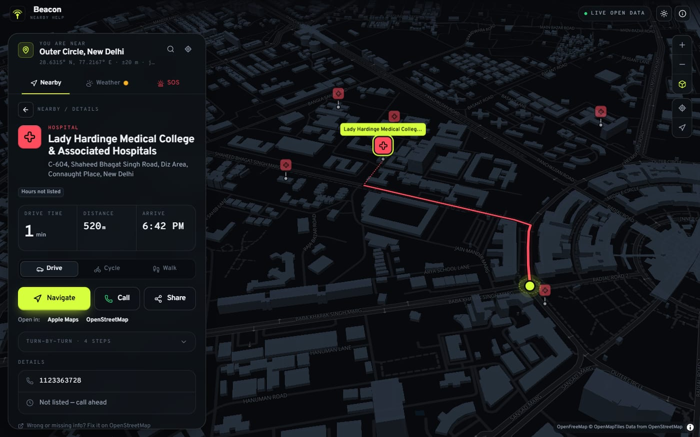
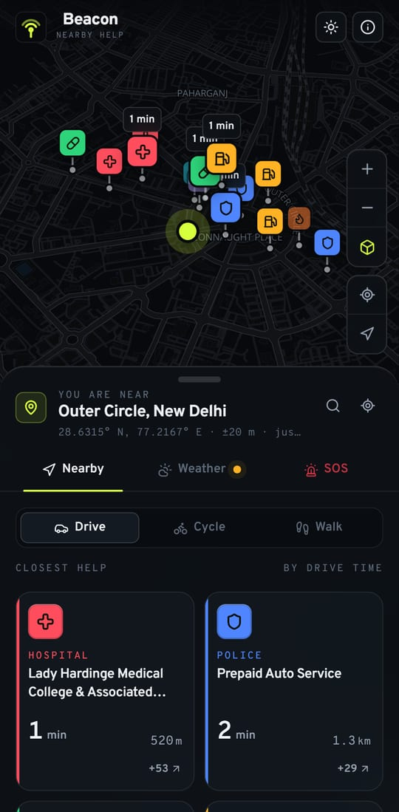
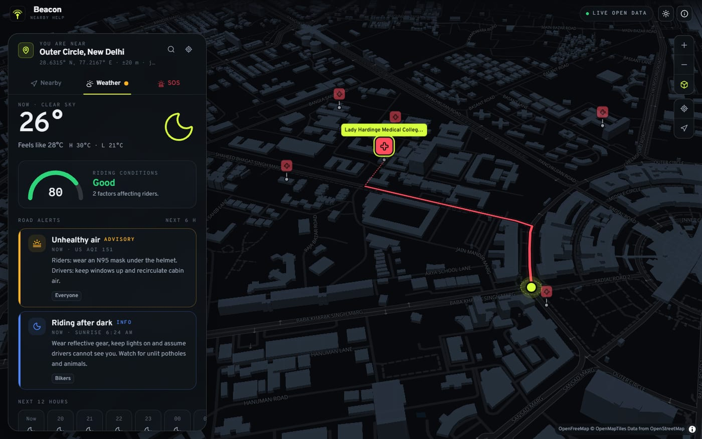
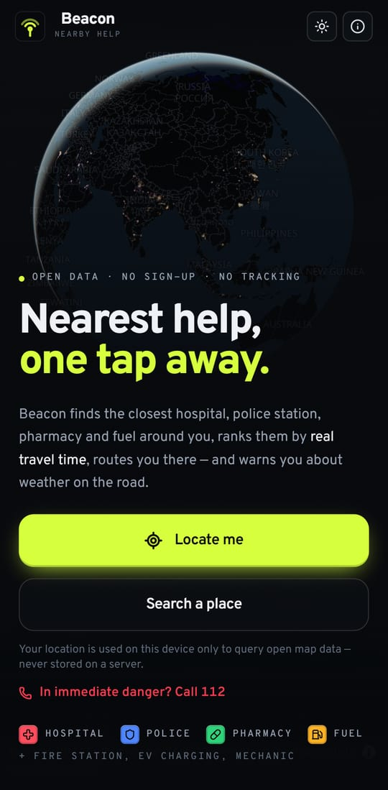
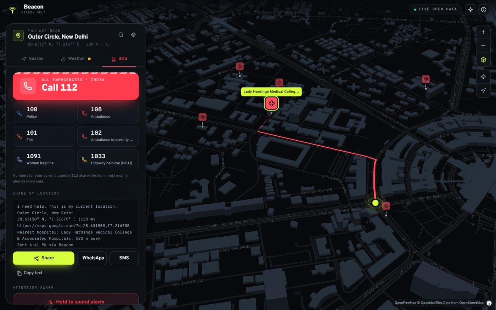
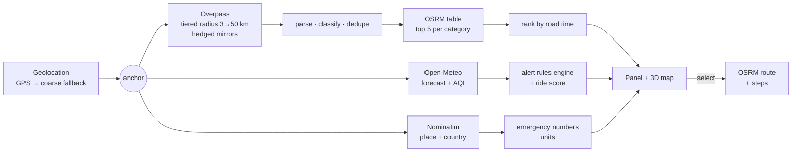

<div align="center">


# Beacon — nearby help, one tap away

**The nearest hospital, police station, pharmacy and fuel — ranked by real travel time, routed, and paired with weather alerts for the road.**
Free, open data. No accounts. No tracking. No AI.

### [**Open the live app → beacon-nearby-help.vercel.app**](https://beacon-nearby-help.vercel.app)

[](https://github.com/Jeevan2410/beacon-nearby-help/actions/workflows/ci.yml)




</div>

---

## What it does

Open Beacon, tap **Locate me**, and within seconds you see the closest help around you:

|                                    |                                                                                                                                                                                                      |
| ---------------------------------- | ---------------------------------------------------------------------------------------------------------------------------------------------------------------------------------------------------- |
| **One-tap summary**                | Nearest hospital, police, pharmacy and fuel — plus fire stations, EV chargers and mechanics/tyre shops.                                                                                              |
| **Ranked by road, not by crow**    | Straight-line nearest is often wrong (rivers, rail yards, one-ways). Beacon asks a router for real drive / cycle / walk times and ranks by those.                                                    |
| **Routes & directions**            | Route drawn on a 3D map, turn-by-turn steps, arrival time, and one tap to hand off to Google Maps, Apple Maps or OpenStreetMap.                                                                      |
| **Road-weather alerts**            | Thunderstorms, heavy rain, fog/visibility, crosswinds, heat, black ice, UV, darkness and air quality — graded _advisory → danger_, with a **riding-conditions score** for bikers.                    |
| **SOS**                            | The right emergency numbers for the country you're in, one-tap call, share your location (native share, WhatsApp, SMS), a hold-to-trigger alarm siren, trusted contacts and an on-device medical ID. |
| **Works when the network doesn't** | Installable PWA. The app shell, map tiles you've seen and your last results are cached, so the last-known nearest hospital is still there in a dead zone.                                            |
| **Private by design**              | There is no Beacon server. Your location goes only to the public map/weather services to answer "what's near me"; contacts and medical info never leave the device.                                  |

<table>
  <tr>
    <td></td>
    <td></td>
  </tr>
  <tr>
    <td></td>
    <td></td>
  </tr>
</table>

## Free APIs — no sign-up, no keys

Every service is free and key-less. Beacon respects their fair-use policies (client-side pacing, caching, mirror failover).

| Service                                                                                  | Used for                                                | Sign-up                     | Fair use                                          |
| ---------------------------------------------------------------------------------------- | ------------------------------------------------------- | --------------------------- | ------------------------------------------------- |
| Browser Geolocation API                                                                  | Your position                                           | — (HTTPS + user permission) | —                                                 |
| [Overpass API](https://wiki.openstreetmap.org/wiki/Overpass_API) (3 mirrors)             | Hospitals, police, pharmacies, fuel… from OpenStreetMap | No                          | ~10k queries/day per user; hedged across mirrors  |
| [OSRM](https://project-osrm.org/) demo + [FOSSGIS](https://routing.openstreetmap.de/)    | Travel-time matrix & routes (car / bike / foot)         | No                          | ≤ 1 request/s — paced in the client               |
| [Open-Meteo](https://open-meteo.com/)                                                    | Forecast & air quality                                  | No                          | Free for **non-commercial** use (< 10k calls/day) |
| [OpenFreeMap](https://openfreemap.org/)                                                  | Vector map tiles & styles                               | No                          | No limits                                         |
| [NASA GIBS](https://earthdata.nasa.gov/gibs)                                             | Black Marble night-lights on the globe                  | No                          | Public domain                                     |
| [Nominatim](https://nominatim.org/) · [Photon](https://photon.komoot.io/) · BigDataCloud | Address & place search                                  | No                          | ≤ 1 req/s, cached                                 |

> Going commercial or high-traffic? Open-Meteo needs a paid licence for commercial use, and the OSRM/Overpass public instances are donated capacity — self-host them or use a paid provider. Swapping is a one-line change in [`src/config/endpoints.ts`](src/config/endpoints.ts).

## How it works



A few decisions worth knowing:

- **Tiered search.** One Overpass query covers every category within 3 km. Only categories still missing (or that only found a clinic, not a hospital) are re-queried at 10 → 25 → 50 km. In a city that's a single request; on a highway it widens automatically.
- **Hedged requests.** Public Overpass mirrors are often at capacity. Beacon queries the preferred mirror, races the next one if it hasn't answered within 6 s, jumps immediately on a fast failure, and aborts the losers.
- **Road-time ranking.** The 5 straight-line-nearest candidates per category go into one OSRM _table_ request; the summary card prefers a real hospital over a quicker clinic.
- **Search anchor.** Live tracking moves your dot continuously but only re-searches after you've moved 800 m, so it doesn't hammer donated infrastructure.
- **Opening hours** are evaluated in the _place's_ time zone with an in-house parser for the common OSM syntax; anything richer is reported as unknown rather than guessed.
- **Weather alerts** come from a pure, unit-tested rules engine with thresholds from standard meteorological and road-safety guidance — deterministic, no AI.

## Tech stack

| Layer    | Choice                                                                                              |
| -------- | --------------------------------------------------------------------------------------------------- |
| App      | React 19 · TypeScript (strict) · Vite 8                                                             |
| Map      | MapLibre GL JS 6 — globe projection, 3D buildings, atmosphere                                       |
| Data     | TanStack Query (persisted to localStorage) · Zustand                                                |
| UI       | Tailwind CSS 4 · Motion · Lucide · Overpass & Overpass Mono typefaces                               |
| PWA      | vite-plugin-pwa (Workbox) — precache + runtime tile cache                                           |
| Quality  | Vitest (84 unit tests) · Playwright (end-to-end, mocked APIs, desktop + mobile) · ESLint · Prettier |
| CI/CD    | GitHub Actions · Vercel / GitHub Pages / Cloudflare Pages · Dependabot                              |
| Security | Strict Content-Security-Policy, Permissions-Policy, HSTS (one source: [`vercel.json`](vercel.json)) |

## Getting started

Requires Node.js 22+.

```bash
npm install
npm run dev          # http://localhost:5173
```

Geolocation needs a secure context: `localhost` works; on a phone use the deployed HTTPS URL.

| Script             |                                                                |
| ------------------ | -------------------------------------------------------------- |
| `npm run dev`      | Dev server with hot reload                                     |
| `npm run build`    | Typecheck + production build (+ `_headers`)                    |
| `npm run preview`  | Serve the build with production security headers               |
| `npm test`         | Unit tests                                                     |
| `npm run test:e2e` | End-to-end tests (builds first; uses installed Chrome locally) |
| `npm run check`    | Typecheck + lint + unit tests                                  |
| `npm run format`   | Prettier                                                       |

## Deploying

Push to GitHub, then import the repo in Vercel — that's it. Every push to `main` deploys to production and every pull request gets a preview URL. Full step-by-step (Vercel, GitHub Pages, Cloudflare Pages, custom domains) in **[docs/DEPLOYMENT.md](docs/DEPLOYMENT.md)**.

## Project layout

```
src/
  config/        categories (OSM tags), API endpoints
  features/
    places/      Overpass query builder, parser, opening-hours evaluator
    routing/     OSRM table/route client, turn instructions
    weather/     Open-Meteo client, alert rules engine, WMO codes
    emergency/   emergency numbers, share links, Web Audio siren
    location/    geolocation, reverse geocoding, place search
  data/          TanStack Query hooks and ranking
  map/           MapLibre view, style theming, markers, overlays, camera
  components/    landing, panel, nearby / weather / SOS views, UI primitives
  lib/           resilient HTTP (timeouts, pacing, failover, hedging), geo, formatting
e2e/             Playwright specs + API mocks
```

## Roadmap

- Hindi and other Indian-language UI
- Offline region packs (pre-download an area before a trip)
- "Along my route" search for highways
- Optional self-hosted Overpass/OSRM profile for heavy use

## Credits & licence

Map data © [OpenStreetMap](https://www.openstreetmap.org/copyright) contributors (ODbL). Weather by [Open-Meteo](https://open-meteo.com/) (CC BY 4.0). Tiles by OpenFreeMap / OpenMapTiles. Night lights by NASA Earth Observatory / GIBS.

Code released under the [MIT licence](LICENSE).

> Beacon is an aid, not an emergency service. Listings come from volunteers and can be incomplete — in an emergency, call your local emergency number.
